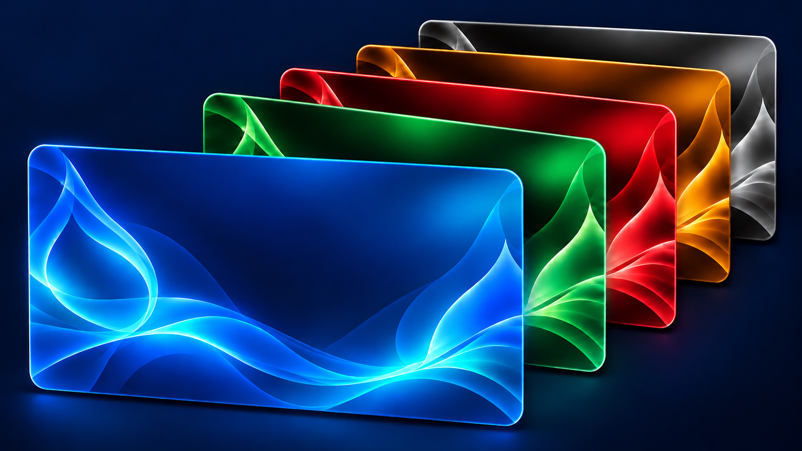

# Clear Layers

Drupal 11 用の、半透明のパネル・柔らかなぼかし・重なりによる奥行きを備えた独立したカスタムテーマです。Drupal Core Starterkit を基礎とし、親テーマを必要としません。



- 機械名: `clear_layers`
- バージョン: `1.1.3`
- 検証環境: Drupal 11.4.9 / Canvas 1.12.0
- 親テーマ: なし（`base theme: false`）

v1.1.3 では、標準サイトロゴに５色を追加し、背景画像に合わせた自動選択と見本付きの手動選択に対応しました。テーマ紹介画像も５色を重ねた構図に更新しました。変更内容と更新方法は [リリースノート](docs/releases/v1.1.3.md) を参照してください。ロゴと文字の配置、Canvas の初期構成、同梱背景・12種類の配色も引き続き利用できます。

## 導入方法を選ぶ

導入方法は、次のどちらかを選んでください。

- **Blank などを使う新規サイトで Canvas の構成を作る**：[新規サイトの Canvas 初期構成](#新規サイトの-canvas-初期構成)へ進みます。テーマ設定のボタンで共通パターンとテンプレートを用意できます。
- **Byte・Mercury などで作った Canvas ページがある**：[移行ガイド](docs/migration.md)へ進みます。初期構成ボタンは、保存済みのページや旧テーマの部品を移行する機能ではありません。Blank でも既存の Canvas 構成がある場合はこちらです。

Byte・Mercury などの Canvas 対応テーマからの移行は、Codex CLI などの生成AIを活用し、実際のサイト構成に合わせて調査・実装・検証を進めることを前提に案内しています。**移行作業を始める前に、[migration.md](docs/migration.md) をよく読んでください。**

ガイドには、SSH と Codex CLI の作業例、移行を依頼するプロンプト例、手動の確認手順を掲載しています。

## 主な機能

- 青・緑・赤・琥珀色・モノクロをもとにした配色、透過、背景のぼかし、奥行き。
- 基調色がわかる12種類の配色、同梱の背景画像、左右余白・ブロック間隔をテーマ設定で調整。
- 訪問者の OS 設定に従う明暗モードと、小さな切り替えボタン。
- Canvas で利用できる SDC。ナビゲーション、ヘッダー、フッター、Hero、記事ヘッダー、カード、本文、案内ページ、一覧など。
- ブログ本文・コードブロックの明暗対応、長いコードの横スクロール。
- 記事カード全体を通常のリンクとしてクリック可能。キーボード・Ctrl／中クリックに対応。
- サイト共通ヘッダー・フッターを Canvas パターンから参照する部品。
- テーマ設定の折りたたみプレビュー。
- 小さい画面では高さを抑えたヘッダーと、アイコンで開閉する検索パネル。
- テーマの配色と質感に合わせた公開操作パネル・ステータスメッセージ。

## インストール

通常のカスタムテーマと同様に、ファイルをテーマディレクトリへ配置し、管理画面からインストールできます。ビルド済み CSS・JavaScript を含むため、利用するだけなら Node.js は不要です。

以下は通常の導入例です。既存の Canvas 対応テーマから移行する場合は、先に [migration.md](docs/migration.md) に沿って移行計画を確認してください。既定テーマの変更だけでは、Canvas の保存済みコンポーネント参照やブロック配置は移行されません。

Drupal プロジェクト直下で実行する例:

```sh
git clone https://github.com/NBE03xxx/ClearLayersTheme.git web/themes/custom/clear_layers
composer require 'drupal/twig_field_value:^2.0' 'drupal/twig_tweak:^3.2'
```

1. 管理画面の「機能拡張」（`/admin/modules`）で **Twig Field Value** と **Twig Tweak** を有効にします。
2. 「外観」（`/admin/appearance`）で **Clear Layers** を「インストールしてデフォルトに設定」します。
3. 「設定」（`/admin/appearance/settings/clear_layers`）で配色・背景・余白などを調整します。

Drush を使う場合:

```sh
vendor/bin/drush en twig_field_value twig_tweak -y
vendor/bin/drush theme:install clear_layers -y
vendor/bin/drush config:set system.theme default clear_layers -y
vendor/bin/drush cr
```

公開ディレクトリが `web` 以外の場合は、そのディレクトリ内の `themes/custom/clear_layers` に配置してください。GitHub の ZIP を使う場合も、展開したディレクトリ名を `clear_layers` にします。

## 新規サイトの Canvas 初期構成

Blank などから新しいサイトを作る場合は、テーマ設定のボタンで共通ヘッダー・フッターとページテンプレートを用意できます。**Canvas 1.12 以降の 1.x、Taxonomy、Views** が必要です。Canvas が未導入なら、Drupal プロジェクト直下で追加・有効化します。

```sh
composer require 'drupal/canvas:^1.12'
vendor/bin/drush en canvas taxonomy views -y
```

テーマのインストール後は、次の順で進めます。画面ごとの操作、生成内容、重複表示の対処、Blank の整理は [Canvas 初期構成の手順](docs/canvas-setup.md)を参照してください。

1. Canvas で最初のページを作成・公開し、URL エイリアスを `/home` にします。
2. テーマ設定（`/admin/appearance/settings/clear_layers`）の「Canvas の初期構成」を開きます。
3. 新規サイトでは「『サイト共通レイアウト』をサイトの既定テンプレートにする」にチェックし、「Canvas の初期構成を作成」をクリックします。
4. 生成された共通ヘッダー・フッターを編集し、サイトのメニューやロゴを設定します。
5. Home のページテンプレートは「Site Default」のままで利用できます。本文側には Hero・本文・一覧などを配置し、テンプレートから表示されるヘッダー・フッターを重ねて配置しないようにします。
6. 「サイトの基本設定」（`/admin/config/system/site-information`）でフロントページを指定し、公開ページと Canvas の編集・公開を確認します。

| 作成するもの | 内容 |
| --- | --- |
| 共通パターン | サイト共通ヘッダー `site_header`、サイト共通フッター `site_footer` |
| ページテンプレート | サイト共通レイアウト `site_layout`、分類・タグの一覧 `taxonomy_listing` |
| 補助モジュール | 同梱の Clear Layers Canvas Taxonomy を有効化。分類ページのテンプレート割り当てと新規フッターメニューの表示階層の初期値を設定 |
| 補助モジュール | 同梱の Canvas Library Display を有効化。Library の Components タブで配置できる部品が0件のフォルダーを非表示にする |

ボタンはその場で公開済みの設定を作成し、既存の同じ ID の構成は上書きしません。共通構成以外のページ・コンテンツタイプ・フィールド・記事・メニュー項目・分類・Views・画像は利用者が用意します。対象に未公開の変更や検証エラーがある場合は、Canvas で整理してから実行してください。

保存済みの Canvas 構成があるサイトでは、先に [移行ガイド](docs/migration.md)を確認してください。初期構成ボタンは旧テーマの部品への参照を変換しません。

## 初期設定

「外観 → Clear Layers の設定」（`/admin/appearance/settings/clear_layers`）で、配色・背景・質感・余白を調整します。

| 設定 | 初期値 |
| --- | --- |
| 配色 | 青 × シアン（オーシャンブルー） |
| 透過率 | 40% |
| ぼかし | 12px |
| 奥行き | 標準 |
| 左右余白 | 12px |
| ブロック間隔 | 24px |
| 背景 | 同梱の青い背景画像 |
| 標準ロゴ | 背景画像に合わせて５色から自動選択 |
| 明暗モード | 訪問者の OS 設定 |

12種類の配色と同梱背景を選択でき、配色と画像は別々に設定します。背景はサムネイル一覧の「選択」で指定し、フォームを保存するとサイト全体に反映されます。メディアへの登録は不要です。プレビューはクリックして展開できます。

既存サイトの保存済み設定は、テーマの更新だけでは上書きしません。配色一覧、背景画像の追加、以前のメディア背景の扱いと更新手順は [配色・背景・ロゴの設定](docs/theme-settings.md)を参照してください。

## Gin のメディアプレビュー補正と更新時の扱い

Drupal 11.4.9／Gin 5.0.15 で記事編集画面の画像プレビューが縦長になる場合は、任意の補正 CSS を利用できます。Clear Layers のインストールだけでは適用されません。配置方法と、Core・Gin 更新後に補正を外せるか確認する手順は [記事編集画面の設定](docs/article-editing.md#gin-のメディアプレビュー補正と更新時の扱い)を参照してください。

## 記事編集画面で段落をインデントする場合

段落のインデントには、任意の拡張モジュール **CKEditor IndentBlock** とエディター設定が必要です。テーマの必須依存ではなく、テーマを更新するだけでは有効になりません。導入コマンド・ツールバー・許可 HTML の設定は [段落インデントの手順](docs/article-editing.md#記事編集画面で段落をインデントする場合)を参照してください。

## サイトロゴ

標準ロゴは青・緑・赤・琥珀色・モノクロの５種類です。テーマ設定の「サイトロゴ」で、背景画像に合わせた自動選択（初期値）または色の手動選択ができます。明暗の見本と更新時の扱いは [標準ロゴの色](docs/theme-settings.md#標準ロゴの色)を参照してください。

背景透過の「自鯖」ロゴを同梱しています。テーマ設定から指定して利用でき、この画像はダークモードで白く表示します。ロゴとサイト名の配置は「右」「下」から選択できます。画像パスの指定、ロゴだけの表示、Canvas のブランディングブロックの設定は [ロゴの使い方](docs/theme-settings.md#自鯖ロゴ)を参照してください。

## Canvas とページレイアウト

Canvas はテーマ単体の必須依存ではありません。Canvas で部品を使う場合は、使う SDC をライブラリで有効にします。記事本文・一覧カードのコンテンツテンプレートは、コンテンツタイプとフィールドを用意してから Canvas 側で設定します。

- **案内ページ**：リンク集・サイト方針などを、見出しと本文を持つパネルとして表示します。「ページの見出し」に「見出し」、「本文」に「本文（リッチテキスト）」を配置し、本文幅を75%または100%から選びます。目次・カード状リストには、専用クラス付き HTML を保持できる本文フィールドの参照が必要です。配置・指定方法は [案内ページの使い方](docs/information-page.md)を参照してください。テーマの導入だけでは、既存ページに自動適用されません。
- **共通ヘッダー・フッター**：参照部品 `shared-site-section` が `site_header`／`site_footer` を読み込みます。共通パターンを編集・公開すると、参照するページに反映されます。フッターの枠への配置、メニューのタイトル、ログイン・ログアウト表示は [共通フッターとメニュー](docs/footer.md)を参照してください。
- **記事の表示**：本文を「本文（リッチテキスト）」に割り当てると、コードブロックを含む明暗モードのスタイルが適用されます。記事カード `article-card` の任意の整数 prop `date` に作成日時を渡すと、投稿日時を表示できます。

任意のサイトデータの書き出し・導入は [starter-kit/README.md](starter-kit/README.md)を参照してください。公開リポジトリに実サイトのページ本文・構成・設定の書き出しは含めていません。

## 開発

コンポーネントの Twig・CSS・JavaScript は `components/` 内で管理し、ビルド済みの CSS・JavaScript も配布に含めています。利用するだけなら Node.js は不要です。

ビルド・監視・検証コマンド、Core 由来テンプレートの保守、公開済み SDC の互換性については [開発と検証](docs/development.md)を参照してください。

## ライセンスと由来

GNU General Public License の本文を [LICENSE.txt](LICENSE.txt) に同梱しています。Drupal Core Starterkit を基礎とし、従来のテーマで開発した SDC・ビルドツールを引き継いでいます。既存コードの著作権・ライセンス表記は保持しています。

## 背景画像の制作経緯

背景画像は ChatGPT の画像生成機能を使用して制作したもので、Drupal の公式提供画像ではありません。ファイルと由来は [背景画像の制作経緯](docs/theme-settings.md#背景画像の制作経緯)を参照してください。
